# Architecture (revision 2)

Diagrams for `docs/PLAN.md`. Exact formats are in `docs/PROTOCOL.md`; security rules in `docs/SECURITY.md`
(invariants I1–I12 are referenced below). Each section has one diagram and a few words on why.

Legend: **ours** = code we write · **reused** = published component used unchanged · **external** = a network or
service we call.

---

## 1. System map

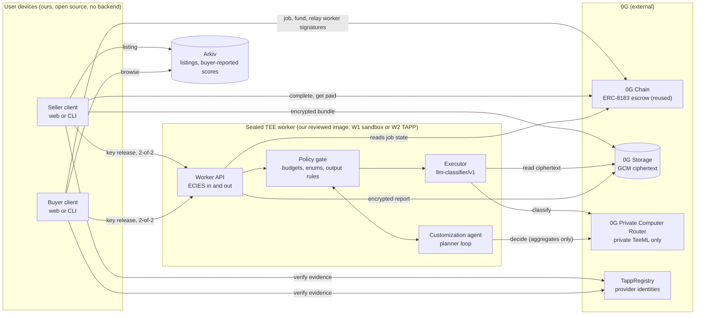

**Why:** the three roles the review separated are three different boxes. The seller's asset is data in Storage. The
customization agent plans. The worker and its policy gate are the only place both assets are ever in plaintext, and
they run inside a TEE that each party verifies itself. We run no server: clients talk to 0G and Arkiv directly.

---

## 2. Roles and authority

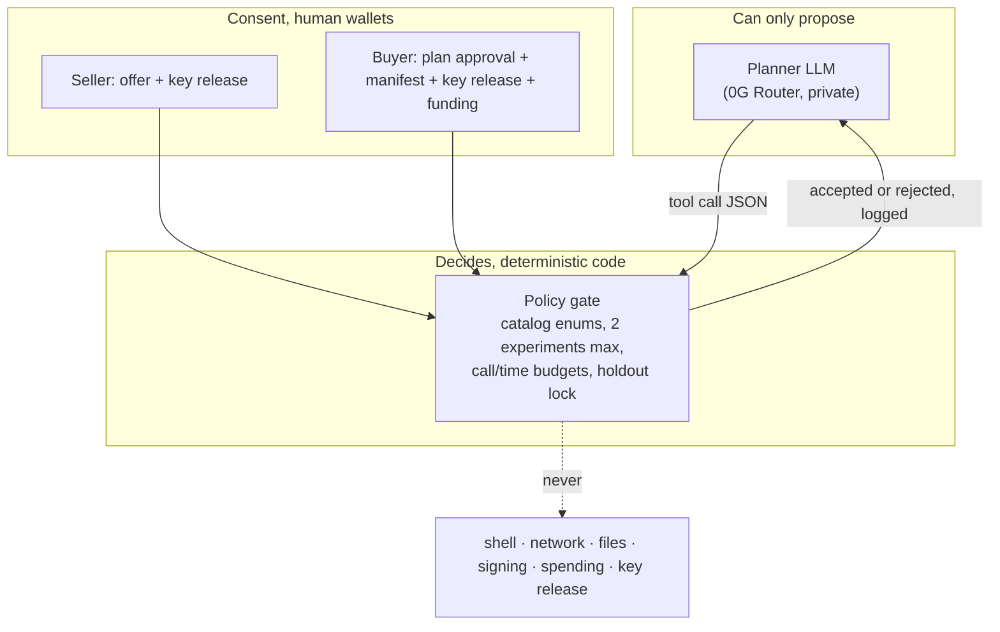

**Why:** an LLM must not hold authority (I5). It picks among enumerated options, and code enforces every limit.
Consent comes only from the two parties' wallets, so neither the LLM nor we can start a job or release a key.

---

## 3. Who builds what

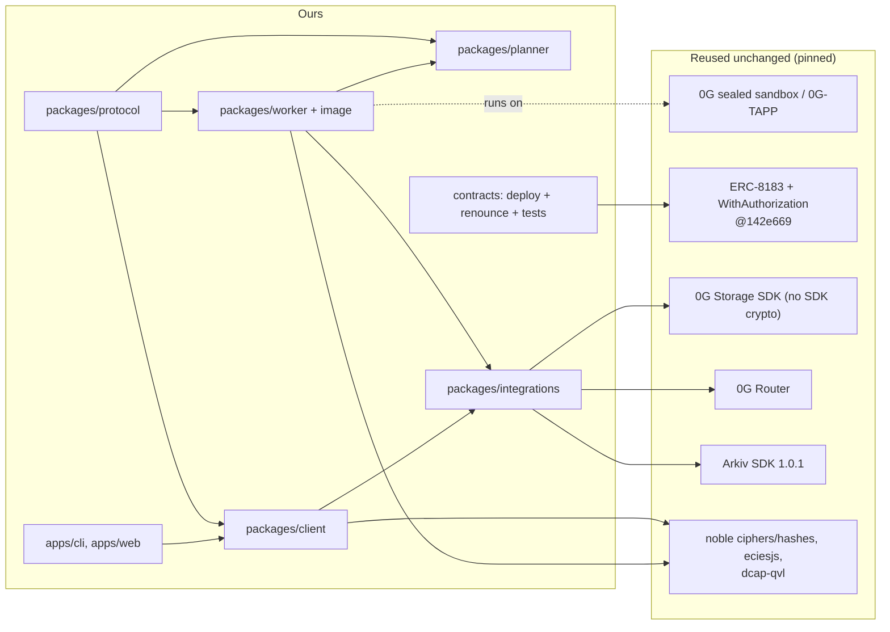

**Why:** security-critical primitives (TEE isolation, attestation, escrow accounting, ciphers) are reused. What we
write is protocol glue, the policy gate and the executor, which is exactly the product-specific part nobody else has
built.

---

## 4. Seller lists an asset

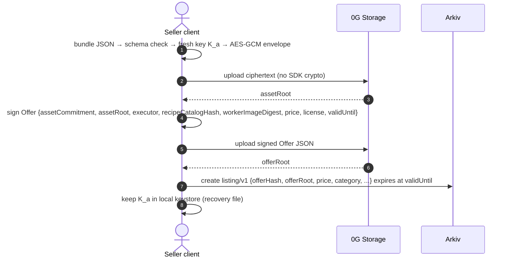

**Why:** the seller pins *which worker image* may ever see the asset (`workerImageDigest`), so a later image change
needs a new offer. The asset is encrypted with an authenticated envelope because the SDK's built-in mode is AES-CTR
without authentication (I10).

---

## 5. Buyer states a goal; the agent proposes a plan

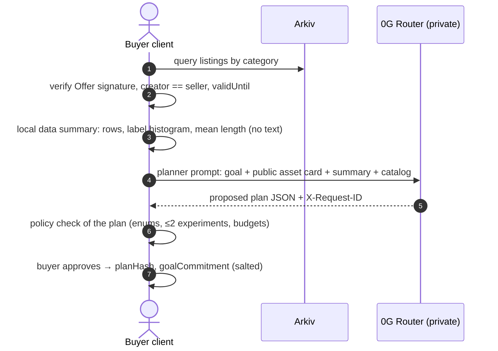

**Why:** the buyer sees and approves the plan before anything is unlocked. Only a numeric summary leaves the buyer's
device, and only to 0G's private tier. The approved plan is a starting point; the agent can adapt it inside the
worker, but only within the same policy.

---

## 6. Worker creation and two-party key release

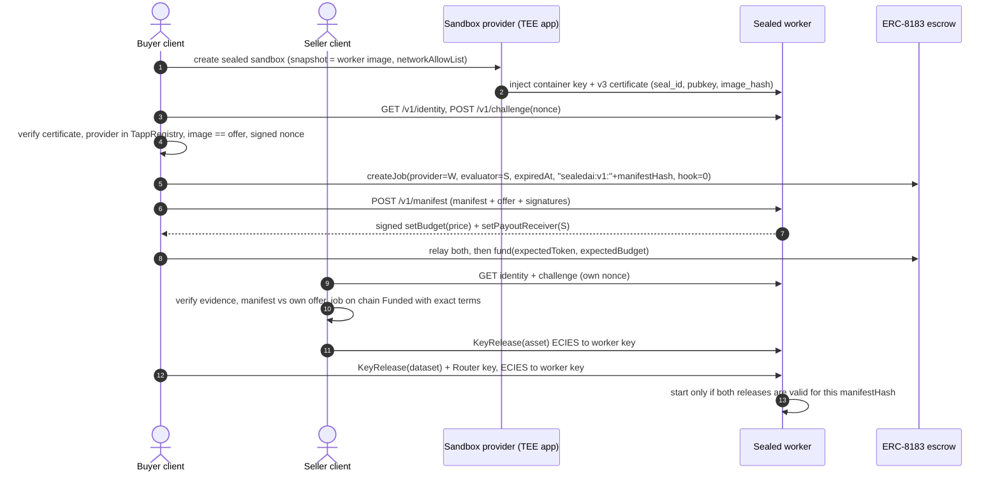

**Why:** each party trusts only what its own client checked (I2), and the worker needs both keys (I1). The worker is
the escrow *provider*, so price and payout come from worker-signed authorizations that the worker issues only if the
seller's signed offer matches. No platform signer is involved, and the seller need not be online to quote. They must
be online to release their key, which is the consent step anyway. For MOCK mode, step 2 is a mock certificate and
every later artifact says MOCK (I12).

---

## 7. Inside the worker

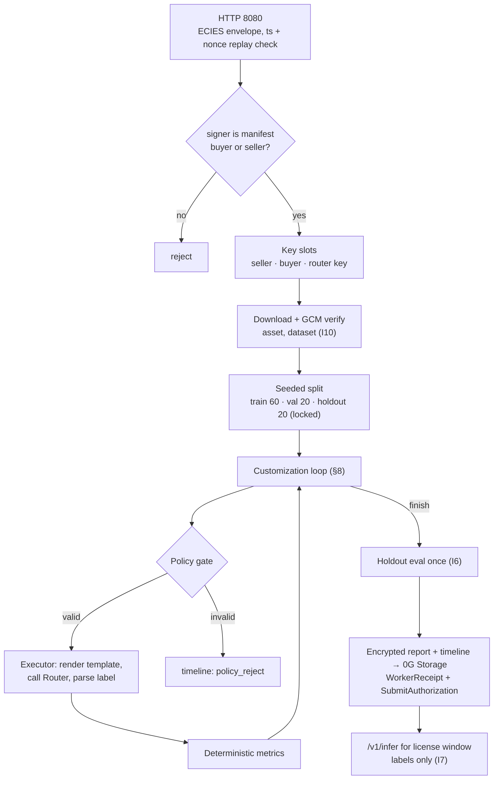

**Why:** one narrow pipe in and out. Inputs are authenticated and encrypted. Keys live only in memory, and a restart
loses them, which ends the job (fail closed). Outputs are fixed shapes: an encrypted report, a signed receipt, and
labels from the label set.

---

## 8. The customization loop

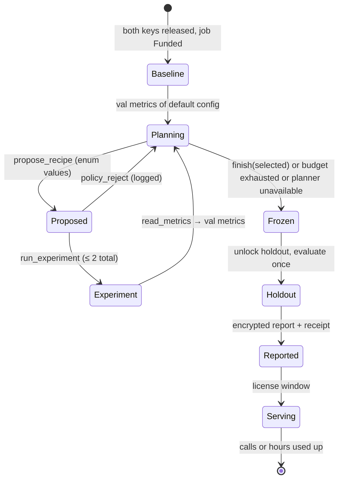

**Why:** this is the loop the review asked to restore: baseline → bounded experiment → validation feedback → next
decision → finish → final holdout. The demo has to show one decision that *changes* because of a validation result
(for example, the agent drops few-shot after k=4 hurts minority classes and tries the other template). Holdout
numbers can't influence selection because the holdout is locked until `Frozen`.

---

## 9. Escrow: roles and states (ERC-8183 reference @142e669)

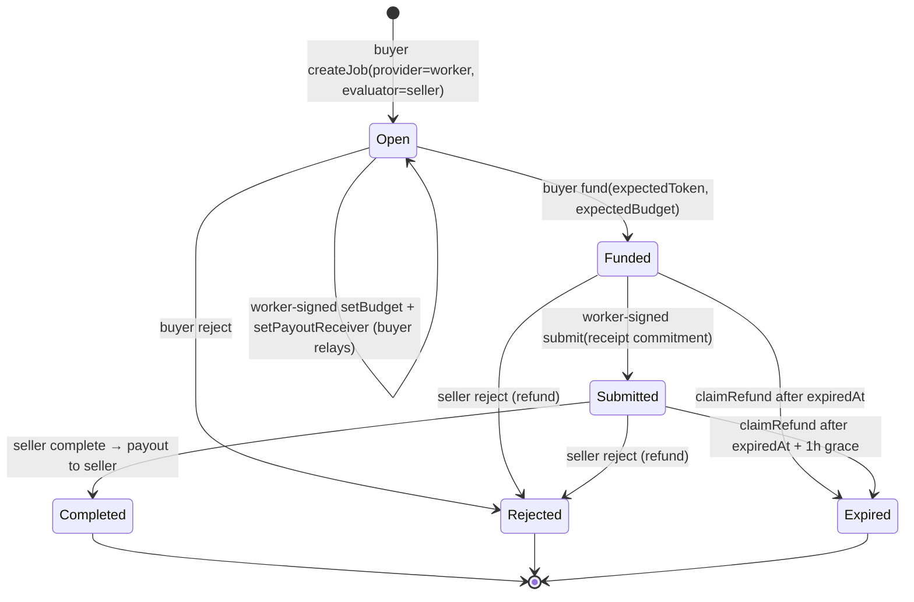

**Why:** the contract enforces `evaluator != provider` and lets only the provider set the budget and submit, so the
worker is the provider and the seller the evaluator. The seller can't be paid unless the worker submitted. The buyer
can't refuse to pay after receiving the result. We never use claims, so `PendingClaimExists` can't block a refund.
Admin roles are renounced after setup (pause, `emergencyWithdraw`, and UUPS upgrade all need them).

---

## 10. Settlement and use

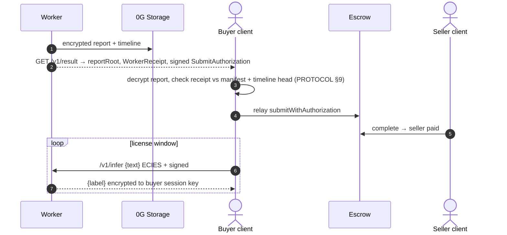

**Why:** the deliverable is usable: the customized classifier is served from the sealed worker for the license
window, so neither side ever sees the combined config in plaintext. Fixed fee, no uplift pricing (the review
pointed out an unvalidated metric shouldn't drive money).

---

## 11. Data at rest

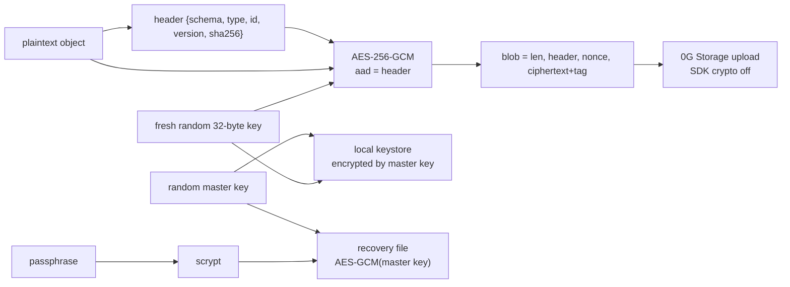

**Why:** random keys, not a wallet-signature-derived secret (signatures are shareable, and recovery across wallet
types isn't guaranteed: review R08). Recovery = file + passphrase, which works on a fresh device with nothing from
us. GCM plus header-bound AAD makes tampering, truncation or a swapped object fail closed.

---

## 12. Trust boundaries: who sees plaintext

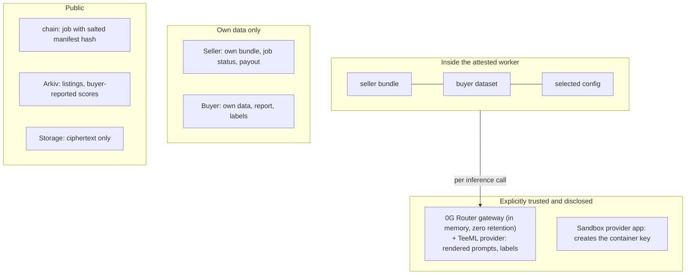

**Why:** the review asked us to name every plaintext recipient (R02). The complete list is in SECURITY §3. The two
trusted third parties are 0G's own TEE-backed services, and we say so instead of hiding them.

---

## 13. Runtime routes and gate G-RT

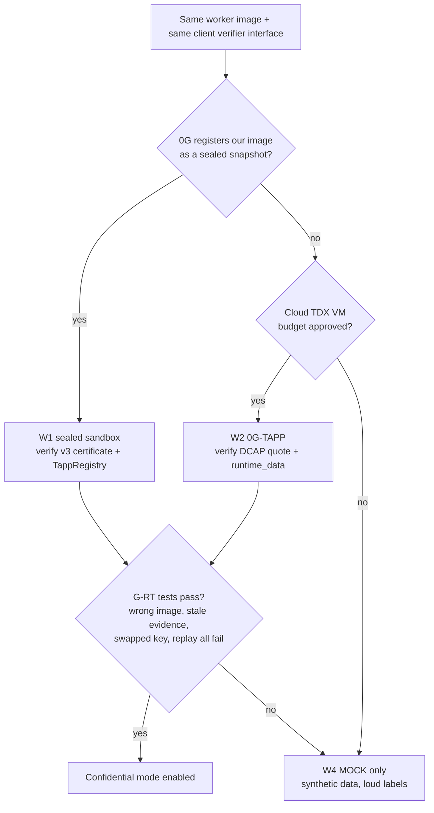

**Why:** the review said not to assume a runtime works until it's shown. The worker and verifier are built once
against an interface with three implementations, so we can demo the full product in MOCK while the real runtime is
being proven, and switch without rewriting anything.

---

## 14. Arkiv catalog

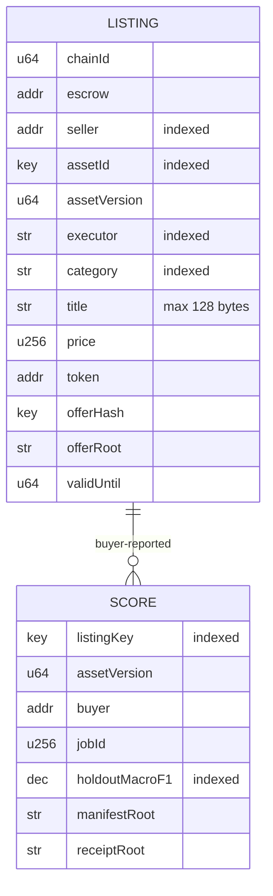

**Why:** public, expiring, wallet-owned data is what Arkiv is for, and the browse page is the user-visible read the
track requires. Bare IDs aren't unique, so every listing carries chain, escrow, asset ID and version (R16). Scores are
always "buyer-reported". The "worker-signed" badge needs a completed job and a receipt that verifies (PROTOCOL §10).

---

## 15. CROPS: what still depends on whom

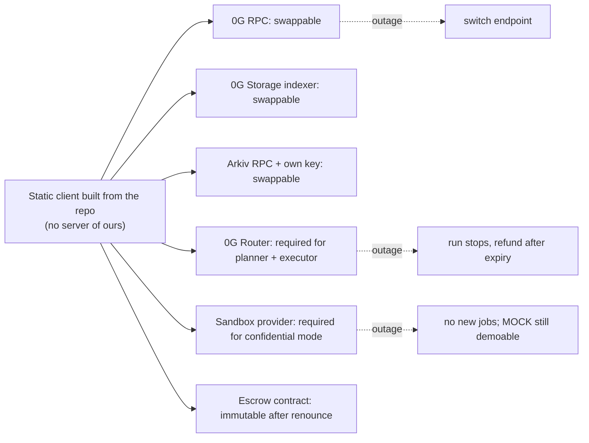

**Why:** CROPS judges reward structural independence and honest trade-offs. We claim independence from *us*, not
from 0G. Refunds work with only an RPC and the contract, so a buyer can always recover funds without any service of
ours (R15).

---

## 16. Build order and gates

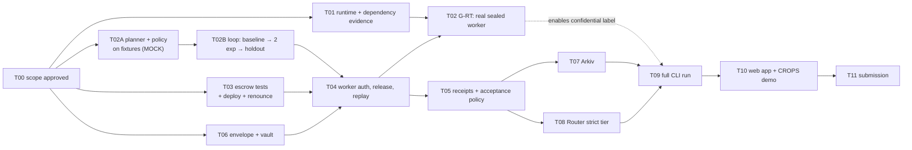

**Why:** the planner, escrow and envelope work don't depend on the runtime, so they proceed in parallel with the
G-RT investigation. The submission depends only on MVP tasks. Confidential mode is a label that switches on when T02
passes, not a blocker for shipping the product loop.
