# Architecture (working name SealedAI, placeholder)

Diagrams for `docs/PLAN.md`. Each section has one diagram and a few words on why it's built that way. Facts come
from the sources listed in PLAN.md; anything not yet confirmed on testnet is marked **VERIFY** and tracked in
`docs/TASKS.md`.

Legend used throughout:
- **Ours**: code we write (kept as small as possible).
- **Reused**: published, maintained components used unchanged.
- **External**: networks and services we call but don't run.

---

## 1. System map

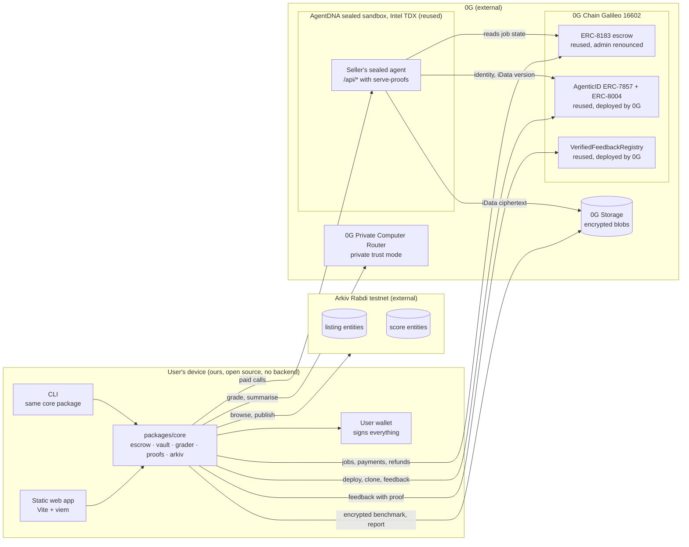

**Why this shape:** every box outside "User's device" already exists and is run by someone else. Our code is a
client plus one small seller service. There's no server of ours in the picture: nothing to breach, nothing that sees
keys, and nothing whose shutdown stops the app (the CROPS lead property). The sealed agent is the only place both
parties' data meet, and it runs on AgentDNA's real TDX hardware rather than a worker we'd have to build and could
only mock here.

---

## 2. Who builds what

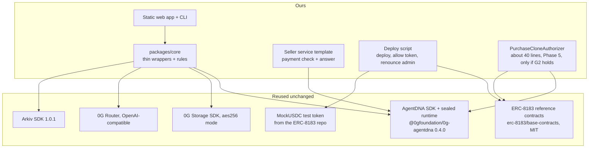

**Why:** the brief is to reuse first. The custom code is glue and policy. Anything security-critical (TEE key
handling, attestation, escrow accounting, proof signing) stays in components that are already deployed, tested and
reviewed by their maintainers.

---

## 3. Seller's agent on AgentDNA

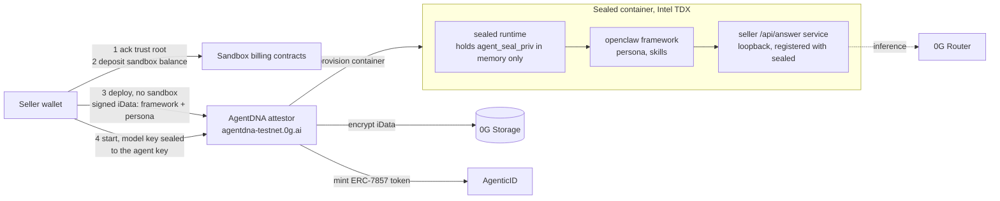

**Why:** the seller's IP (persona, skills, service code) becomes ERC-7857 iData: encrypted on 0G Storage, with the
key sealed so only the agent's TEE can open it. Deploying *without* a sandbox and then calling `start` keeps the
model API key out of the wallet prompt (SDK guide). We pick `openclaw` because it's the default framework with
documented service registration.

**VERIFY (gate G1):** that a seller can ship deterministic service code, either by asking the agent to create it
(the documented "expose a service" path) or by seeding it through the `workspace/` iData role.

---

## 4. Key trust chain inside AgentDNA (reused; what we rely on)

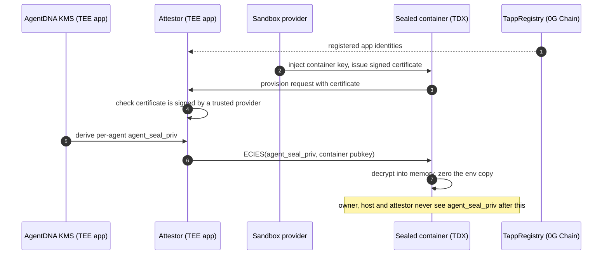

**Why it matters to us:** this chain is our "only approved code gets the keys" guarantee. We don't reimplement it.
We state its assumptions instead: the attestor, KMS and sandbox provider are the acknowledged trust root (`ag.ack()`),
plus Intel TDX and the TappRegistry. Source: `sealed/TRUST_MODEL.md` in `0gfoundation/0g-agentic-id`.

---

## 5. Pay-per-call test drive

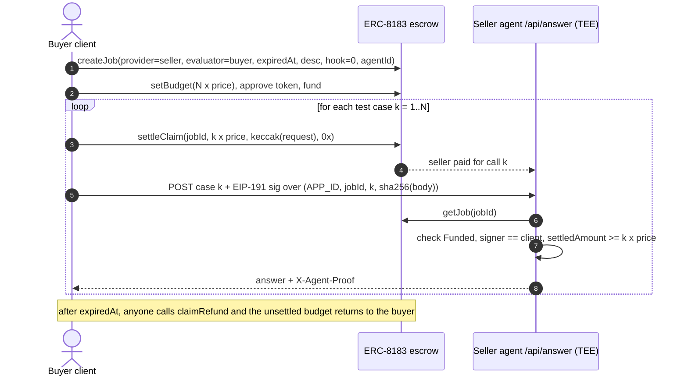

**Why:** paying *before* each call caps both sides' risk at one call. No evaluator has to be trusted, and the buyer
can't use the service and then refuse to pay. `settleClaim` and `claimRefund` are already in the reference contract,
and `claimRefund` can't be blocked by hooks. Fixed per-call prices follow the review advice: no outcome-based
pricing until benchmark integrity is proven.

---

## 6. Escrow state machine (reference ERC-8183, unchanged)

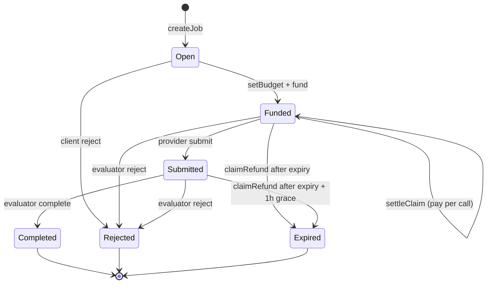

**Why:** we only use the `Funded → Funded` streaming loop plus `Expired` for test drives. `Completed` is used later
by the "buy" flow. After setup, the deploy script renounces the admin roles (pause, `emergencyWithdraw`, upgrade), so
we can't touch escrowed funds. A test proves it.

---

## 7. Proofs, report and feedback

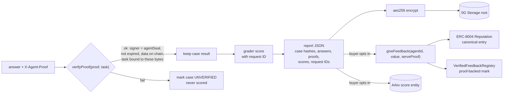

**Why:** a serve-proof proves *which* agent, in *which* iData version, produced *these exact bytes*. It does not
prove the answer is right; that's the grader's job, and the report keeps the two apart. Feedback must carry a proof
the buyer earned, and only that buyer can redeem it, so fake reviews cost real paid calls.

---

## 8. Benchmark vault

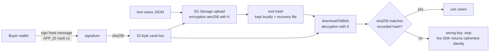

**Why:** the buyer can always recover the vault key from their wallet alone, with nothing from us (CROPS: recoverable
without a server). The hash check exists because the 0G SDK returns ciphertext instead of an error when the key is
wrong (seen in `examples/02`). **VERIFY:** that the wallets we target sign deterministically (RFC 6979); if one
doesn't, we fall back to a key file.

---

## 9. Grader on 0G Private Computer

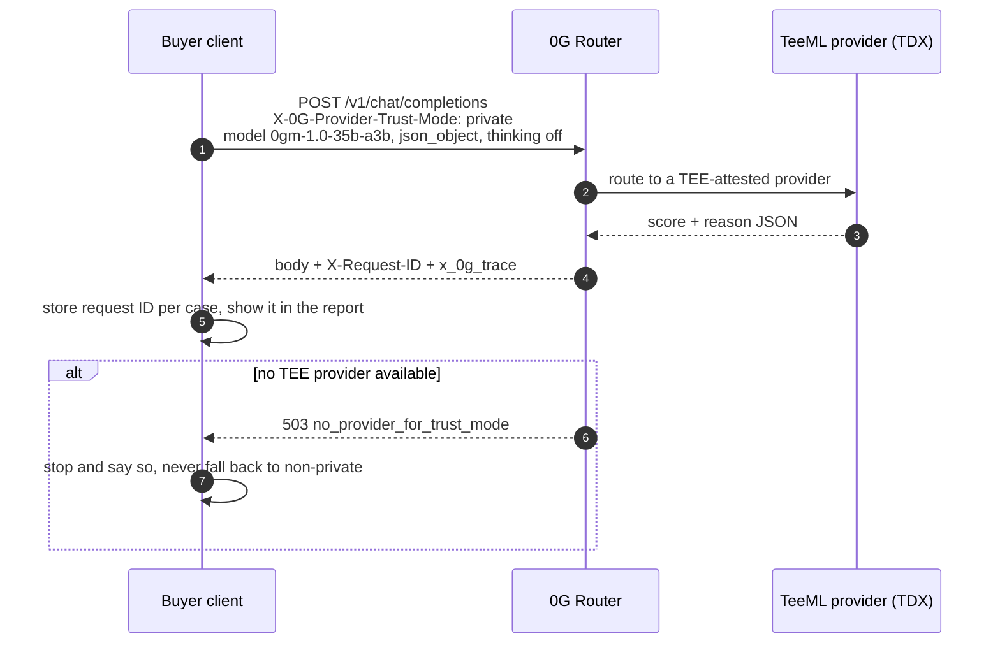

**Why:** this puts 0G Private Computer inference in the main user flow with visible request IDs, which the 0G track
requires. AI is the product here: it turns a raw benchmark into a judgement and a plain-English summary. Limit,
disclosed in the UI: 0G's gateway sees prompts in plaintext ("tier 2.5"). Buyers can pick local exact-match grading
instead.

---

## 10. Arkiv catalog

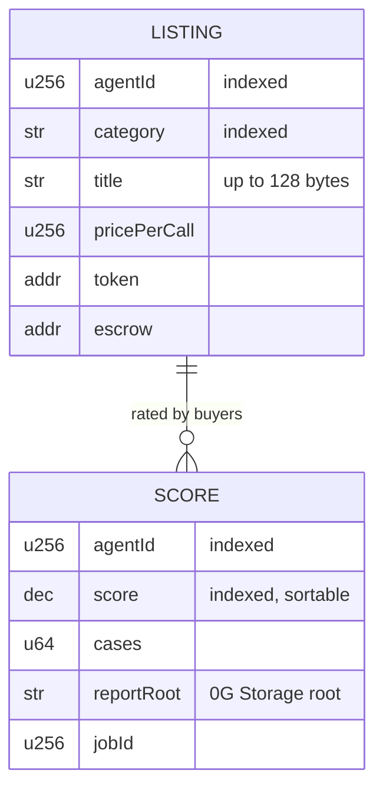

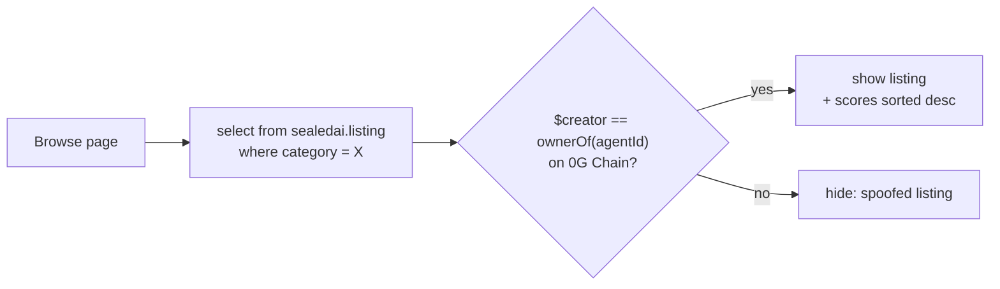

**Why:** listings and opt-in scores are public by nature, and expire on their own (Arkiv expiration), so the catalog
needs no database of ours. Arkiv is a public database anyone can write to, so we only trust a listing written by the
agent's on-chain owner (Arkiv docs: filter by creator). Private state (jobs in progress, vault roots) never goes to
Arkiv. The browse page is the user-visible Arkiv read the track requires. Column types are from Arkiv's documented set;
exact builder syntax is confirmed in T1.6.

---

## 11. Buy flow (Phase 5, shape decided by gate G2)

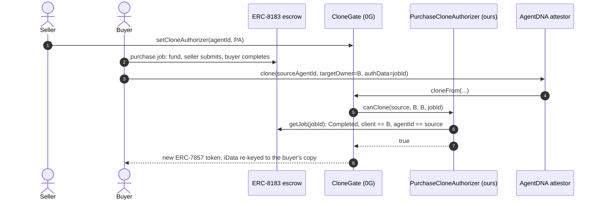

**Why:** 0G already built the marketplace-fork path (`ICloneAuthorizer`, issue #133). Our only contract is the
policy: "yes iff this buyer completed a purchase job for this agent". **Gate G2** checks first whether a buyer who owns
a copy can simply ask it for the seller's prompt. If they can, we sell ongoing hosted access instead (the flow in §5
with a long-lived job) and don't ship this.

---

## 12. Trust boundaries: who can see what

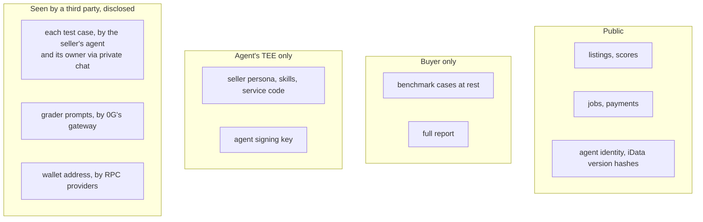

**Why:** stating this up front is how we keep claims honest. The three items in the bottom box are known limits
(PLAN §5). L1 is the biggest one, and it's on the roadmap ("test drive on a clone neither party owns").

---

## 13. CROPS: running without us

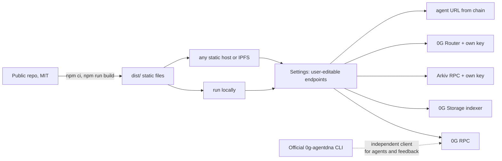

**Why:** the lead property is censorship resistance, and here it's structural. There's no backend to switch off,
and every endpoint can be swapped. The demo builds from a fresh clone, swaps RPCs, and completes a test drive. The
official AgentDNA CLI is a second, independent client that 0G maintains, so users don't even need our UI to verify an
agent or leave feedback. Stretch: publish the `dist/` hash so anyone can check the hosted copy matches the repo.

---

## 14. Build order and gates

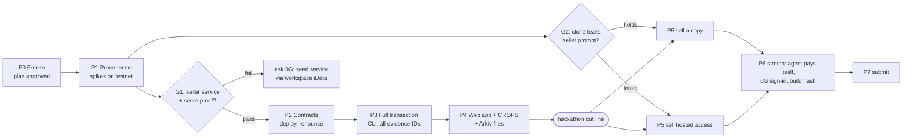

**Why:** we prove each borrowed piece on testnet before building on it. G1 is the one gate that could change the
architecture, so it runs first. Phases 1 to 4 are a complete submission; everything after the cut line is a bonus.
