# Architecture (revision 3)

Diagrams for `docs/PLAN.md`. Formats: `docs/PROTOCOL.md`. Rules: `docs/SECURITY.md` (invariants I1–I12). Each
section has one diagram and a few words on why. Legend: **ours** = code we write · **reused** = published component,
unchanged · **external** = a service we call.

---

## 1. System map

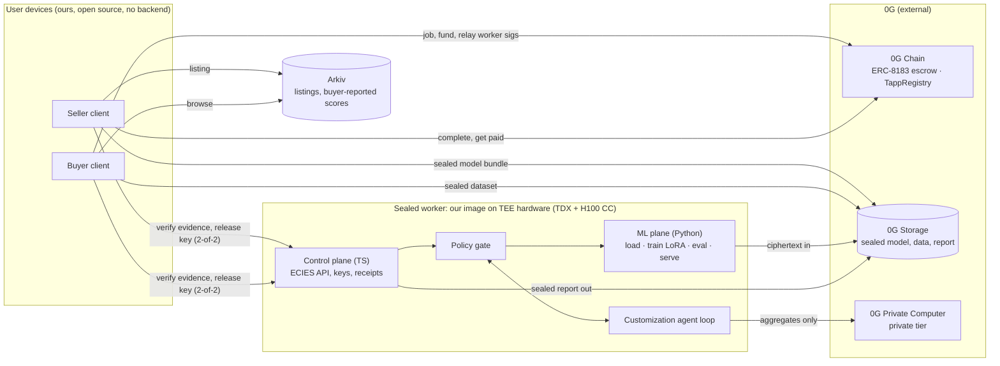

**Why:** the seller's weights and the buyer's rows meet only in the box labelled TEE, and nothing in that box sends
either one anywhere. The only line to the 0G Router carries aggregate numbers and the public model card (D10). That
fixes rev 2, where every classifier call carried assets through the Router gateway. We run no server; clients talk
to 0G and Arkiv directly.

---

## 2. Roles and authority

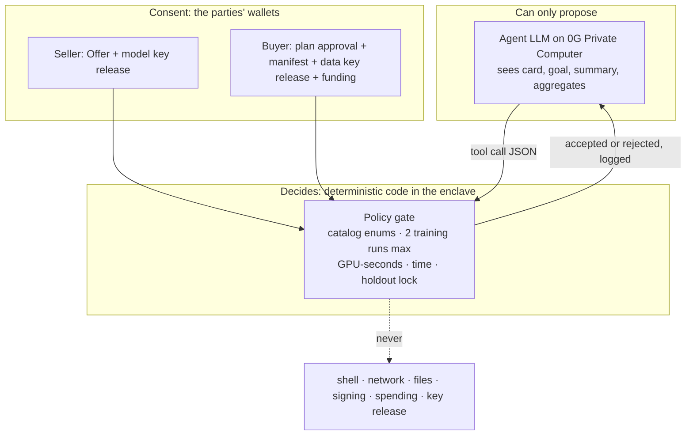

**Why:** the agent decides *how to train*, which is the product. Authority stays with code and the two wallets (I5).

---

## 3. Who builds what

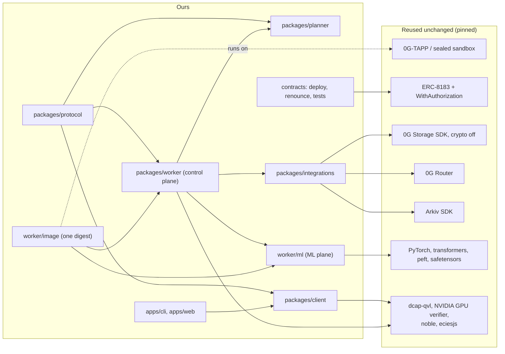

**Why:** TEE isolation, attestation, escrow accounting, ciphers and the ML frameworks are reused. What we write is
the protocol, the policy gate, a safe model loader, and the training/eval/serve wrapper.

---

## 4. Seller lists a model

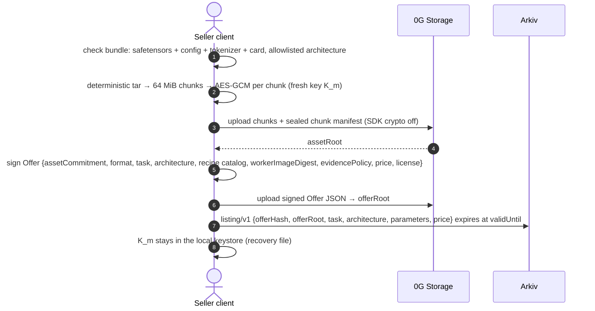

**Why:** the seller pins the exact worker image and the evidence policy (for example "TDX + H100 CC required") in a
signed Offer, so their key can only ever go to that code on that class of hardware. B1 (standard formats) means no
seller code ever runs (I4).

---

## 5. Goal → plan

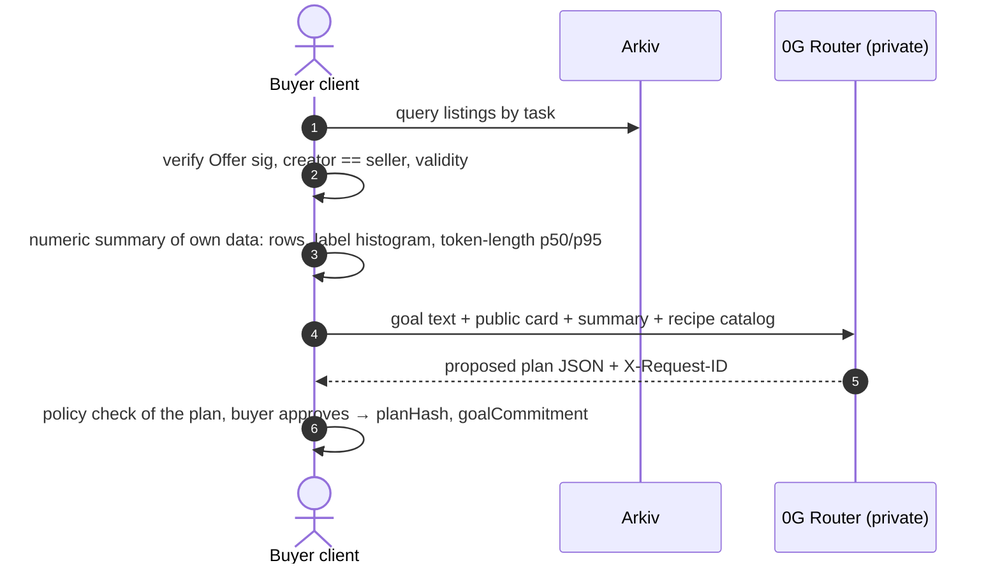

**Why:** the buyer sees and approves the plan before anything is unlocked. Only numbers and the goal text the buyer
wrote leave the device, and only to 0G's private tier.

---

## 6. Worker boot, verification and 2-of-2 release

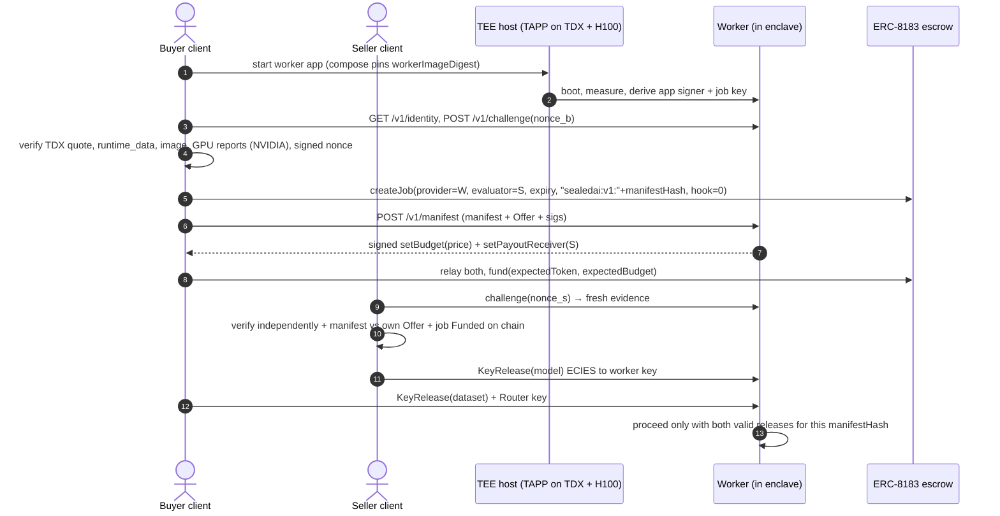

**Why:** the buyer deploys the worker but can't reach inside it (TAPP's "malicious deployer" model), and the seller
re-verifies everything with its own nonce instead of trusting the buyer. No valid CPU + GPU evidence means no key
leaves either client. There's no mock path (I12).

---

## 7. Inside the worker

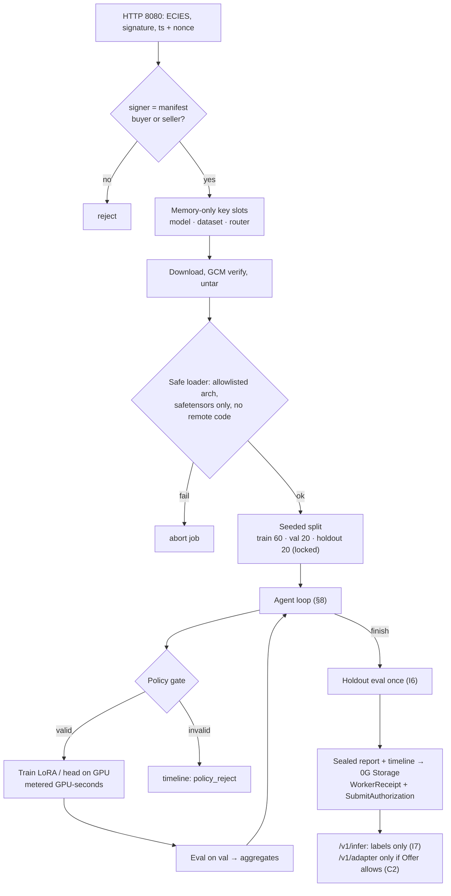

**Why:** the control plane (TS) owns keys, protocol and policy. The ML plane (Python) only computes and talks to the
control plane over a local pipe, with no network of its own. Keys are memory-only, so a crash ends the job (fail
closed).

---

## 8. The customization loop (real training)

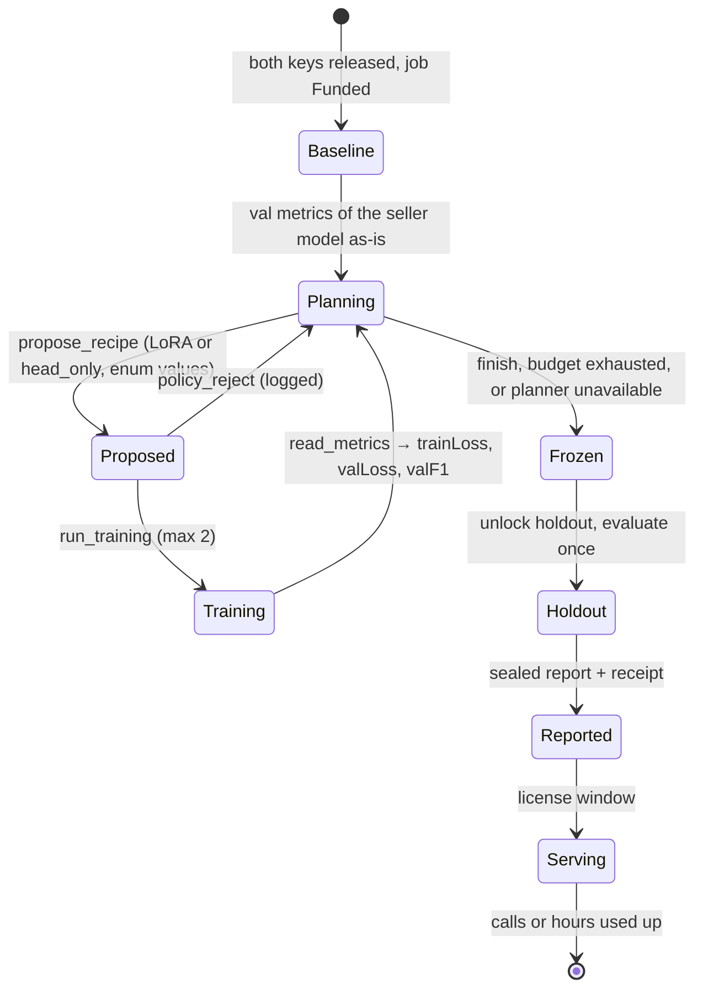

**Why:** baseline → bounded training → validation feedback → next decision → finish → final holdout, the loop the
review asked for, now with real weight updates. The demo has to show one decision changing because of a validation
result: for example, run 1 (LoRA r=16, lr 2e-4) overfits (train loss down, val F1 down), so the agent switches to
r=8, lr 5e-5 with balanced class weights.

---

## 9. Escrow roles and states (ERC-8183 @142e669, unchanged)

**Why:** the contract requires `evaluator != provider`, and only the provider can budget and submit. So the attested
worker is the provider and the seller the evaluator: the seller can't be paid without a worker submission, and the
buyer can't withhold payment after receiving the result. No claims are used; admin roles are renounced.

---

## 10. Settlement and use

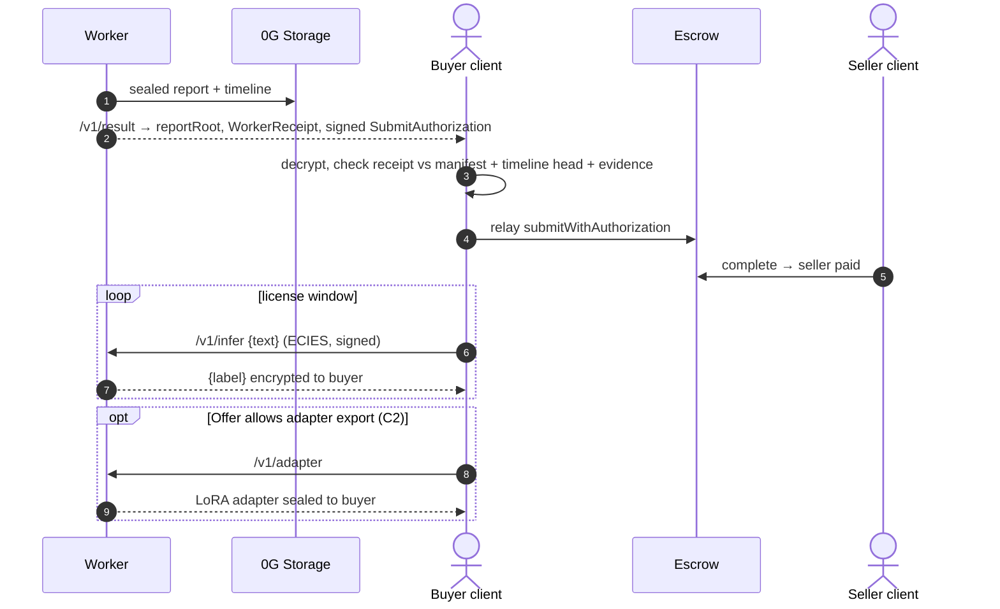

**Why:** the default deliverable (C1) is the customized model served from the enclave, so nobody ever holds the
combined weights. C2 hands the buyer the adapter they paid to train, but it's only useful with a licensed base model.

---

## 11. Data at rest

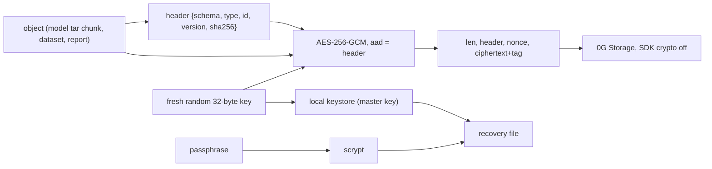

**Why:** authenticated encryption with header-bound AAD makes tampering, truncation or object swaps fail closed (the
SDK's own mode is unauthenticated AES-CTR). Random keys plus a passphrase recovery file restore everything on a fresh
device without us (R08).

---

## 12. Trust boundaries: who sees plaintext

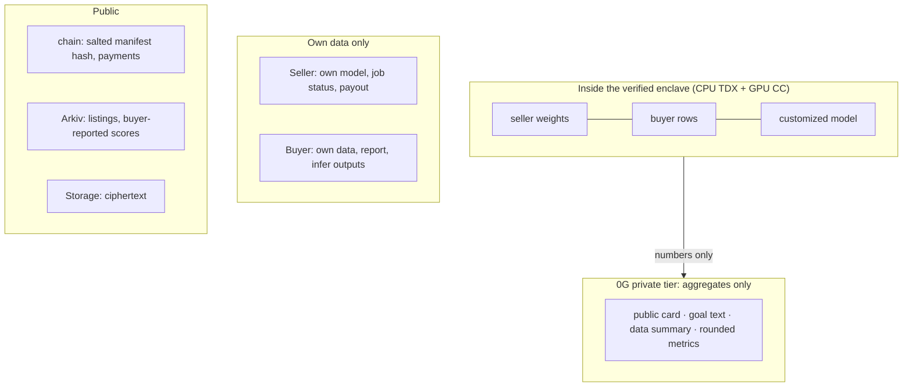

**Why:** the user's rule is that no operator or compute provider can reach either asset on its own authority. The
only thing that leaves the enclave towards a third party is numbers, and the buyer sees every one of them in the
timeline.

---

## 13. Hardware routes and gate G-RT

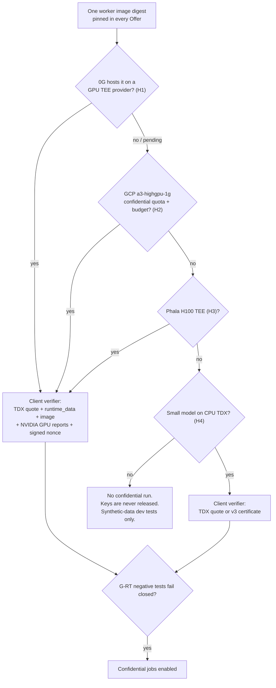

**Why:** there's no mock mode. Every route ends either in verified evidence or in "no keys released". The worker and
the verifier have one interface with per-runtime evidence checkers, so the route can change without touching the
product. TAPP's GPU build doesn't verify the GPU report signature itself; our client does, against NVIDIA.

---

## 14. Arkiv catalog

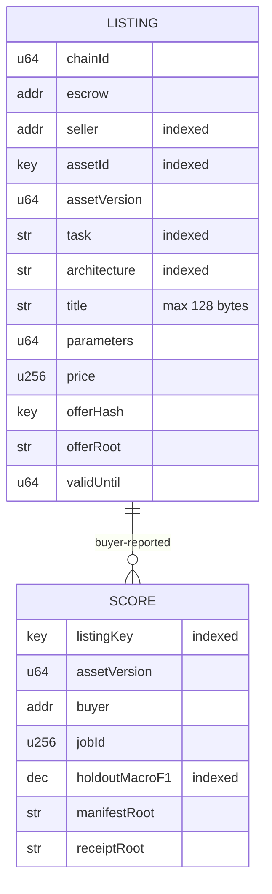

**Why:** public, expiring, wallet-owned listings are what Arkiv is for, and the browse page is the user-visible read.
Namespaced IDs avoid collisions (R16); scores carry provenance and stay labelled "buyer-reported" (R12).

---

## 15. CROPS: dependency and failure matrix

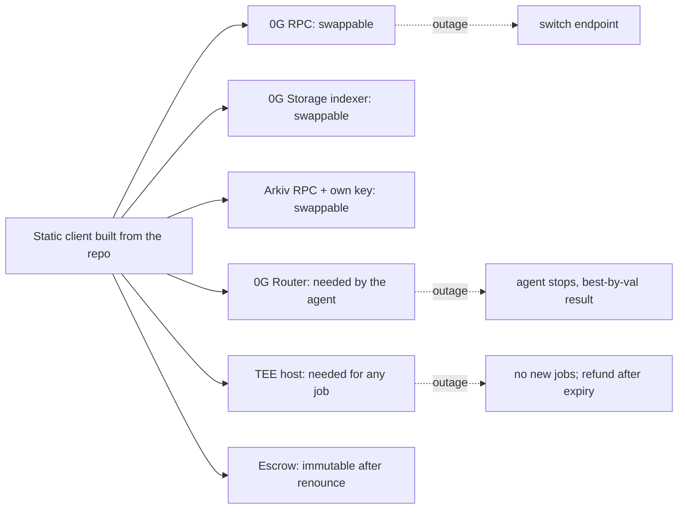

**Why:** we claim independence from *us*, not from 0G or the TEE host. Refunds need only an RPC and the contract (R15).

---

## 16. Build order and gates

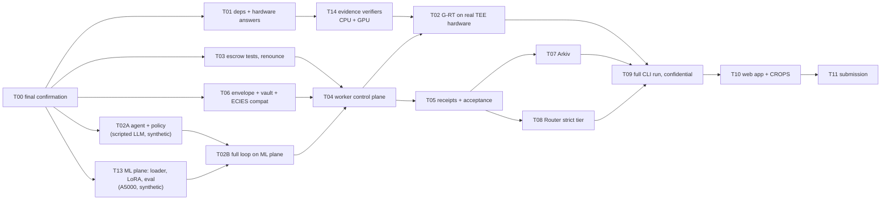

**Why:** everything except T02 and T09 can be built and tested now on this server with synthetic data. The
confidential end-to-end run (T09) depends on real hardware passing G-RT, which is why the hardware request (T01)
starts on day 1.
